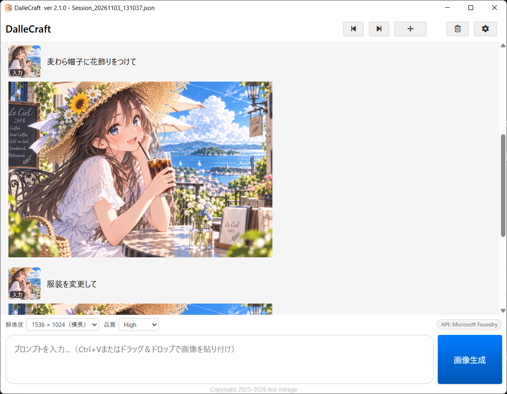

#  DalleCraft クイックスタートガイド

Copyright (c) 2025-2026 led-mirage

## 💎 この資料について

この資料ではOpenAIのAPIを利用する場合の手順を簡単に紹介します。

## 💎 スクリーンショット

## 💎 事前準備

- [OpenAI PlatformのAPIキー管理画面](https://platform.openai.com/api-keys)でAPIキーを作成してください。
- [OpenAI PlatformのAPI課金画面](https://platform.openai.com/settings/organization/billing/overview)で支払い方法またはプリペイドクレジットを設定してください。ChatGPTの有料プランとは別にAPI利用料金が発生します。
- 詳細は[OpenAI API Quickstart](https://developers.openai.com/api/docs/quickstart)をご確認ください。

## 💎 インストール

1. このツールを配置するディレクトリを作成します。
2. [Releasesページ](https://github.com/led-mirage/DalleCraft/releases)からZIPファイルをダウンロードして、作成したディレクトリに解凍します。

## 💎 設定

- OSの環境変数に`OPENAI_API_KEY`を追加し、作成したAPIキーを設定してください。
- Windowsの場合、`環境変数の編集`で検索すると設定画面が出てきます。
- DalleCraftを起動中に環境変数を追加・変更した場合は、アプリを再起動してください。

## 💎 実行

DalleCraft.exeをダブルクリックして起動します。

### 基本的な使い方

1. プロンプト入力欄へ生成したい画像の説明を入力します。
2. 必要に応じて、解像度と品質を選択します。
3. 参照画像を使う場合は、`Ctrl+V`またはドラッグ＆ドロップで画像を最大2枚添付します。プロンプトでは添付順に「1枚目」「2枚目」と指定できます。
4. 「画像生成」ボタンをクリックします。

## 💎 GPT Image 2.5 APIの利用料金

GPT Image API利用料金は[OpenAIの公式サイト](https://developers.openai.com/api/docs/pricing)でご確認ください。

入力・画像出力トークン等に応じて課金され、モデル、画像サイズ、品質によって料金が異なります。

参照画像を添付した場合は、入力画像にも料金が発生します。最大2枚まで添付でき、各画像はPNG、JPEG、WebP形式の20MB未満のファイルにしてください。長辺が2048pxを超える画像は、送信前に縦横比を維持して自動縮小します。
