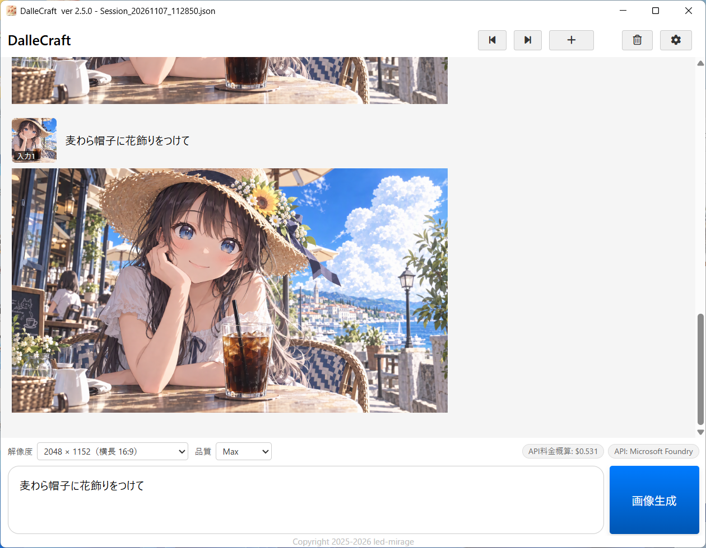
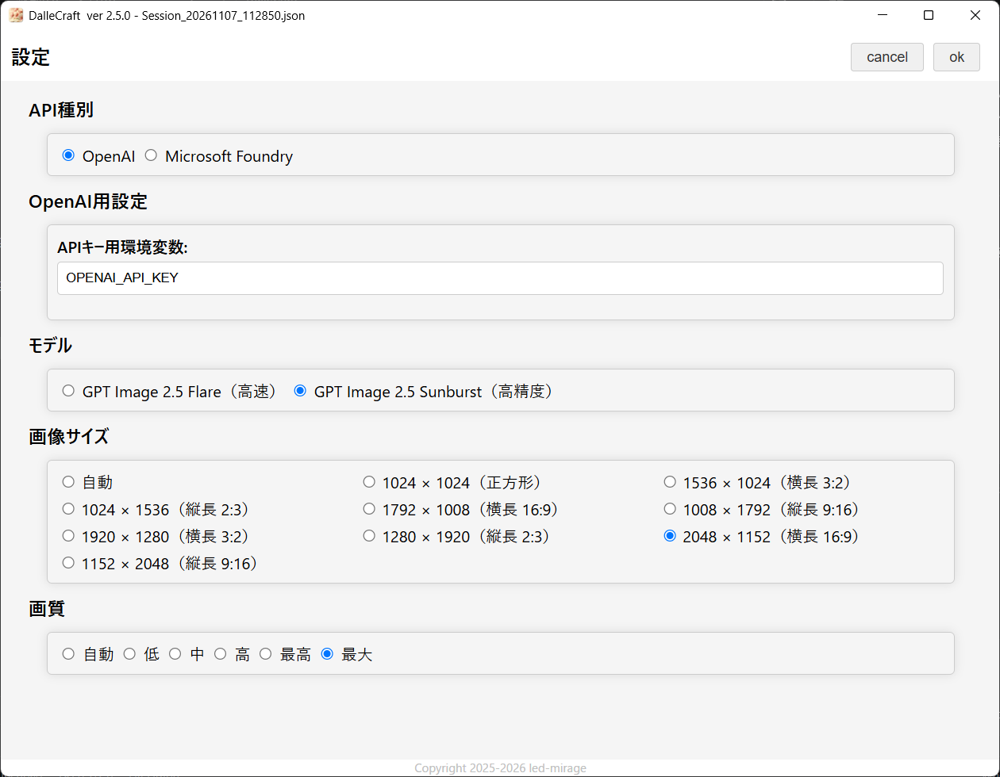

#  DalleCraft

[](https://github.com/led-mirage/DalleCraft/releases)
[](https://github.com/led-mirage/DalleCraft/releases)
[](LICENSE)

Copyright (c) 2025-2026 led-mirage

## 💎 概要

DalleCraft（ダリ・クラフト）は、GPT Image 2.5を利用した画像生成アプリケーションです。

OpenAI API、Microsoft Foundryに対応しています。GPT Image 2.5 FlareとGPT Image 2.5 Sunburstを切り替えて利用できます。

手早く開始したい方は、[クイックスタートガイド](QuickStart.md)をご参照ください。

<div class="page"/>

## 💎 スクリーンショット

<br>
<br>

### 🖼️ 作例

<div class="page"/>
<br>
※ 解像度：2048 x 1152、品質：Max

## 💎 特徴

このアプリはAIを使って手軽に高画質な画像を作りたい人、高性能なPCを持っていない人にとって便利なツールです。

### 主な機能

- テキストプロンプトからGPT Image 2.5による画像を生成
- GPT Image 2.5 FlareとGPT Image 2.5 Sunburstを切り替えて利用可能
- OpenAI APIとMicrosoft Foundryに対応
- `Ctrl+V`またはドラッグ＆ドロップで参照画像を最大2枚添付した画像生成に対応
- メイン画面から解像度と画質を変更できるクイック設定
- 生成画像の右クリックメニューから画像をクリップボードへコピー
- 生成画像の右クリックメニューから、その画像を参照元にした編集を開始
- 元のプロンプトと参照画像を使った画像の再作成
- 拡大表示した画像をマウス操作でズーム・移動
- 生成画像と入力画像をセッションごとに保存し、過去の履歴を閲覧可能

### メリット

- 高画質な画像を手軽に生成できます。
- 高性能なPCは必要ありません。
- セッションごとに画像が保存されるので、画像の管理がしやすいです。
- 過去のセッションの画像の閲覧が可能です。

### デメリット

- APIの利用料金が発生します。※本アプリ自体は無料です。

## 💎 事前準備

### APIキーの取得

### 📌 OpenAIを使用する場合

- [OpenAI PlatformのAPIキー管理画面](https://platform.openai.com/api-keys)でAPIキーを作成してください。

### 📌 Microsoft Foundryを使用する場合

- Microsoft Foundryリソースを作成し、APIキーとOpenAI v1推論エンドポイントを取得してください。
- `gpt-image-2.5-flare`または`gpt-image-2.5-sunburst`をデプロイしてください。両方を切り替える場合は、それぞれのデプロイが必要です。
- デプロイ可能なリージョンは[Microsoftの公式サイト](https://learn.microsoft.com/en-us/azure/foundry/foundry-models/concepts/models-sold-directly-by-azure-region-availability)でご確認ください。

<div class="page"/>

## 💎 インストール

### 📌 実行ファイル（DalleCraft.exe）を使う場合

1. このツールを配置するディレクトリを作成します。
2. [Releasesページ](https://github.com/led-mirage/DalleCraft/releases)からZIPファイルをダウンロードして、作成したディレクトリに解凍します。

### 📌 Pythonで実行する場合

1. プロジェクト用ディレクトリを作成し、移動します。
2. GitHubからソースを取得します：
    ```
    git clone https://github.com/led-mirage/DalleCraft.git
    ```
3. 仮想環境を作成し、アクティベートします（推奨）：
    ```
    python -m venv venv
    .\venv\scripts\activate
    ```
4. 必要なライブラリをインストールします：
    ```
    pip install -r requirements.txt
    ```

## 💎 設定

### 📌 OpenAIを使用する場合

- OSの環境変数にOPENAI_API_KEYを追加し、APIキーを設定してください。
- 使用する環境変数名はアプリの設定画面から変更できます。

### 📌 Microsoft Foundryを使用する場合

- OSの環境変数にAZURE_OPENAI_API_KEYを追加し、APIキーを設定してください。
- OSの環境変数にAZURE_OPENAI_ENDPOINTを追加し、Foundryのデプロイ画面に表示されるOpenAI v1推論エンドポイントを設定してください。
- 使用する環境変数名はアプリの設定画面から変更できます。
- アプリの設定画面でFlareとSunburstのデプロイ名を設定してください。

### 📌 画像サイズのプリセット

メイン画面と設定画面に表示する画像サイズは、`config.json`の`model.size_presets`で変更できます。`auto`または`WIDTHxHEIGHT`形式で指定してください。重複やGPT Image 2.5の制約に合わない値は読み込み時に除外されます。

幅と高さは16の倍数、アスペクト比は1:3から3:1、各辺は3840px以下、総画素数は655,360から8,294,400の範囲で指定する必要があります。設定を変更した場合はDalleCraftを再起動してください。

<div class="page"/>

## 💎 実行方法

📌 実行ファイル（DalleCraft.exe）を使う場合

DalleCraft.exeをダブルクリックして起動します。

📌 Pythonで実行する場合

以下のコマンドを実行します。
```
python src/main.py
```

## 💎 GPT Image 2.5 APIの利用料金

GPT Image API利用料金は[OpenAIの公式サイト](https://developers.openai.com/api/docs/pricing)でご確認ください。Microsoft Foundryを利用する場合は、[Microsoftの公式サイト](https://azure.microsoft.com/en-us/pricing/details/microsoft-foundry/)でご確認ください。

入力・画像出力トークン等に応じて課金され、モデル、画像サイズ、品質によって料金が異なります。

画像生成後、画像を右クリックして「画像情報を表示」を選ぶと、APIレスポンスに含まれる入力・出力・合計トークン数と概算料金を確認できます。概算料金は生成時点の単価とともにセッションへ保存されます。メイン画面には現在表示中のセッションの積算料金も控えめに表示され、マウスを重ねると正確な値と集計件数を確認できます。

概算料金の単価は、`config.json`とは別の`pricing.json`で管理します。`tokens_per_price_unit`は各単価が何トークン当たりかを表し、初期値は100万トークンです。`providers`以下へAPIタイプ、モデル名、テキスト入力・画像入力・画像出力の単価を設定してください。変更はDalleCraftの再起動後に反映されます。

Microsoft Foundryには、Global Standardの公開料金を基にした概算単価を`"*"`で初期設定しています。契約やリージョン等によって実際の料金が異なる場合は、デプロイ名ごとの設定を追加するか、`"*"`の値を変更してください。

```json
"foundry": {
    "*": {
        "text_input": 5.0,
        "image_input": 8.0,
        "image_output": 30.0
    }
}
```

表示される料金は`pricing.json`の値を使った概算であり、実際の請求額を保証するものではありません。APIからトークン情報が返らなかった場合や、利用中のモデルに単価が設定されていない場合は算出されません。

参照画像を添付した場合、その画像は選択中のOpenAI APIまたはMicrosoft Foundryのエンドポイントへ送信され、入力画像にも料金が発生します。参照画像は最大2枚まで添付でき、各画像を20MB未満に制限しています。長辺が2048pxを超える場合は送信前に自動縮小します。

添付した画像はセッション履歴から再表示できるように、縮小後の画像をローカルの`logs/input-images`フォルダへ保存します。生成画像は`images`フォルダ、セッション情報は`logs`フォルダへ保存します。

## 💎 注意事項

### ウィルス対策ソフトの誤認問題

このプログラムの実行ファイル（DalleCraft.exe）はウィルス対策ソフトにマルウェアと誤認されることがあります。

もちろん、このアプリに悪意のあるプログラムは入っていませんが、気になる人は上記の「Pythonで実行する場合」で実行してください。

誤認問題が解決できるのが一番いいのですが、いい方法が見つかっていないので申し訳ありませんがご了承ください。

VirusTotalでのチェック結果は[ここ](https://www.virustotal.com/gui/file/0805191887bb06789a808d00d0d330b35fb23ea335f1225b995782b081712bb4/detection)で確認できます（2026/11/08 v2.6.0）

70個中2個のアンチウィルスエンジンで検出

<div class="page"/>

## 💎 使用しているライブラリ

### 🔖 pywebview 5.4
ホームページ： https://github.com/r0x0r/pywebview  
ライセンス：  BSD-3-Clause license  

### 🔖 openai 3.42.1
ホームページ： https://github.com/openai/openai-python  
ライセンス： Apache License 2.0  

### 🔖 pillow 13.0.0
ホームページ： https://github.com/python-pillow/Pillow  
ライセンス： MIT-CMU License  

### 🔖 Font Awesome Free 6.7.2
ホームページ：https://fontawesome.com/  
ライセンス：Icons: CC BY 4.0, Fonts: SIL OFL 1.1, Code: MIT License

## 💎 使用しているライブラリ（ビルド時）

### 🔖 PyInstaller 6.22.3
ホームページ： https://github.com/pyinstaller/pyinstaller  
ライセンス： GPL 2.0 License / Apache License 2.0  

### 🔖 pyinstaller-versionfile 3.1.0
ホームページ： https://github.com/DudeNr33/pyinstaller-versionfile<br>
ライセンス： MIT License

### 🔖 PyYAML 6.0.3
ホームページ： https://github.com/yaml/pyyaml<br>
ライセンス： MIT License

## 💎 ライセンス

© 2025-2026 led-mirage

本アプリケーションは MITライセンス の下で公開しています。詳細については、プロジェクトに含まれる LICENSE ファイルをご参照ください。

<div class="page"/>

## 💎 バージョン履歴

### 2.6.0 (2026/11/07)

- 生成画像の右クリックメニューから、その画像を参照元にした編集を開始できるように変更
- 生成画像を削除しても、セッションの概算料金から発生済み料金を減算しないように修正

### 2.5.0 (2026/11/07)

- 画像生成に使用したトークン数を画像情報に表示
- `pricing.json`の単価を使った概算料金の表示に対応
- セッションごとの積算料金をメイン画面へ表示

### 2.4.0 (2026/11/07)

- GPT Image 2.5の解像度プリセットを追加
- 解像度プリセットを`config.json`から変更できるように改善

### 2.3.0 (2026/11/05)

- 参照画像を最大2枚まで添付できるように変更

### 2.2.0 (2026/11/04)

- 生成画像をクリップボードへコピーする右クリックメニューを追加
- 拡大表示した画像のズームとドラッグ移動に対応
- 画像の再作成時に元の参照画像も再送信するように変更

### 2.1.0 (2026/11/03)

- 解像度と画質をメイン画面から変更できるクイック設定を追加
- `Ctrl+V`またはドラッグ＆ドロップによる入力画像の添付に対応
- 参照画像を添付した画像生成と、セッション履歴への入力画像の保存・表示に対応
- 入力画像に20MBの容量制限と、長辺2048pxを上限とする自動縮小処理を追加
- メイン画面に現在使用中のAPI種別を表示

### 2.0.0 (2026/11/03)

- GPT Image 2.5 Flare、GPT Image 2.5 Sunburstに対応
- Microsoft FoundryのOpenAI v1エンドポイントに対応
- DALL-E 2、DALL-E 3、GPT Image 1の生成サポートを終了
- 画像サイズの自動選択と`xhigh`、`max`画質に対応
- Pythonのバージョンを3.14.10に更新
- openaiライブラリのバージョンを3.42.1に更新
- Pillowライブラリのバージョンを13.0.0に更新
- PyInstallerのバージョンを6.22.3に更新

### 1.2.0 (2025/11/30)

- Fix: GPT Image 1モデルのパラメータ取得部分に問題があったため修正
- GPT Image 1モデルの動作確認を完了
- openaiライブラリのバージョンを2.8.1に更新
- pillowライブラリをバージョン12.0.0に更新

### 1.1.1 (2025/06/08)

- Hotfix: Azure OpenAI Serviceでの画像生成ができないバグを修正

### 1.1.0 (2025/06/08)

- GPT Image 1モデルに対応
- openaiライブラリのバージョンを1.84.0に更新
- PyInstallerのバージョンを6.14.0に更新

### 1.0.1 (2025/05/17)

- リファクタリングのみ（機能の追加、変更はありません）
    - Applicationクラスのスリム化
    - Serviceクラスの導入

### 1.0.0 (2025/03/30)

- ファーストバージョン
